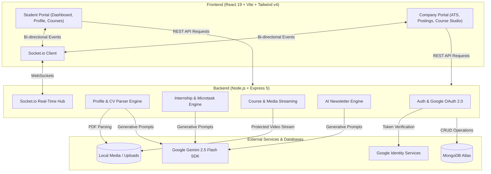

# 🎓 Placify — AI-Powered Placement & Internship Platform

<div align="center">


**Transforming campus recruitment into an intelligent, skill-verified, and real-time talent ecosystem.**

[](https://react.dev/)
[](https://vitejs.dev/)
[](https://nodejs.org/)
[](https://expressjs.com/)
[](https://www.mongodb.com/)
[](https://ai.google.dev/)
[](https://socket.io/)
[](https://tailwindcss.com/)

[Features](#-key-features) • [System Architecture](#-system-architecture) • [Tech Stack](#-tech-stack) • [Getting Started](#-getting-started) • [Environment Variables](#-environment-variables) • [API Reference](#-api-endpoints)

</div>

---

## 📌 Overview

**Placify** is an end-to-end placement and career enablement ecosystem built to solve critical bottlenecks in the college placement and hiring pipeline. Rather than acting as a static resume board, Placify integrates **automated CV parsing**, **Gemini AI candidate-to-job matching**, **dynamic assessment quizzes**, **company-curated video learning modules**, and **instant bi-directional notifications** via WebSockets.

The platform provides a dual-portal experience tailored specifically for **Students** and **Companies / Recruiters**.

---

## ✨ Key Features

### 👨‍🎓 For Students
* **📄 Automated Resume Parsing**: Upload a PDF resume to instantly extract skills, education, and bio highlights using an intelligent PDF parsing engine.
* **🤖 AI Job-Fit Analysis**: Paste any Job Description (JD) and let Google Gemini AI evaluate your resume fit, providing strengths ("What's good") and prioritized skill gaps ("What to improve").
* **🎯 Internship Discovery & 1-Click Apply**: Search, filter (Remote / Hybrid / On-site, Stipend, Skills), and submit applications with immediate delivery to recruiters.
* **📝 Interactive Microtask Assessments**: Complete recruiter-assigned vetting tasks and take dynamic technical quizzes with instant grading and feedback.
* **🎥 Video Courses & Upskilling**: Enroll in courses published by hiring companies and stream video lectures directly inside the platform.
* **⚡ Real-Time Status Alerts**: Receive live notifications the moment an application is shortlisted, accepted, or reviewed.

---

### 🏢 For Recruiters & Companies
* **📢 Internship Management**: Create and manage detailed listings with eligibility criteria, stipends, deadlines, and skill requirements.
* **📊 Comprehensive ATS (Applicant Tracking System)**: Review applicant pipelines, inspect parsed student skills, download original resumes, or generate clean PDF profiles on the fly.
* **🧠 AI-Generated Quizzes**: Automatically convert complex Job Descriptions into multiple-choice assessment quizzes (with answer keys) powered by Gemini AI.
* **📚 Video Course Publishing**: Upload multi-part video courses (`.mp4`) with access control so only enrolled candidates can stream them.
* **📰 AI Newsletter Studio**: Generate ready-to-publish student newsletters from natural language prompts to announce hiring drives and engineering culture.
* **🔔 Live Candidate Notifications**: Get real-time alerts whenever a student applies or submits an assessment.

---

## 🏗️ System Architecture



---

## 💻 Tech Stack

### Frontend
| Technology | Description |
| :--- | :--- |
| **React 19** | Modern component-based declarative UI library |
| **Vite 7** | Lightning-fast build tool and local development server |
| **Tailwind CSS v4** | Utility-first styling framework with full Dark/Light theme support |
| **Framer Motion** | Spring physics animations, staggered transitions, and gesture controls |
| **React Router v7** | Declarative client-side routing with protected route guards |
| **Socket.io Client** | Real-time WebSocket connection for instant alerts |
| **Lucide React** | Clean and consistent iconography |

### Backend
| Technology | Description |
| :--- | :--- |
| **Node.js & Express 5** | Scalable REST API routing and middleware pipeline |
| **MongoDB Atlas & Mongoose 9** | Cloud document database with structured schemas and validation |
| **@google/genai** | Official Google GenAI SDK running Gemini 2.5 Flash |
| **Socket.io** | Event-driven WebSocket server for live updates |
| **JWT & Bcrypt** | Secure stateless authentication and salted password hashing |
| **Multer** | Multi-part form handling for file and video lecture uploads |
| **pdf-parse & PDFKit** | PDF resume text extraction and dynamic PDF generation |

---

## 📁 Project Directory Structure

```text
Placify/
├── backend/
│   ├── config/             # MongoDB connection configuration
│   ├── controllers/        # Route controllers (Auth, Profile, Internship, Course, Newsletter)
│   ├── middleware/         # Auth verification and file upload middlewares
│   ├── models/             # Mongoose schemas (User, Internship, Course, Newsletter, Notification)
│   ├── routes/             # Express API route declarations
│   ├── uploads/            # Storage directory for resumes, profile pictures, and course videos
│   ├── utils/              # Resume parsing heuristics and text extraction (cvParser.js)
│   ├── .env                # Backend environment configuration
│   ├── index.js            # Main Express & Socket.io server entry point
│   └── package.json        # Backend dependencies and scripts
│
├── frontend25/
│   ├── src/
│   │   ├── assets/         # Static images, vectors, and logos
│   │   ├── component/      # Reusable components (Navbar, etc.)
│   │   ├── context/        # React Context providers (AuthContext, ThemeContext)
│   │   ├── pages/          # Application views (Landing, Login, SignUp, Dashboards, Profiles, Courses)
│   │   ├── App.jsx         # App router and root layout
│   │   └── main.jsx        # React DOM entry point
│   ├── .env                # Frontend environment configuration
│   ├── vite.config.js      # Vite configuration
│   └── package.json        # Frontend dependencies and scripts
└── README.md
```

---

## 🚀 Getting Started

### Prerequisites
Make sure you have the following installed on your machine:
* [Node.js](https://nodejs.org/) (v18.0.0 or higher recommended)
* [npm](https://www.npmjs.com/) or [yarn](https://yarnpkg.com/)
* A free [MongoDB Atlas](https://www.mongodb.com/atlas) cluster (or local MongoDB)
* A [Google Gemini API Key](https://aistudio.google.com/)

---

### 1. Clone the Repository
```bash
git clone https://github.com/poorviii19/placify.git
cd placify
```

---

### 2. Backend Setup
1. Navigate to the backend folder:
   ```bash
   cd backend
   ```
2. Install dependencies:
   ```bash
   npm install
   ```
3. Create a `.env` file in the `backend/` directory:
   ```env
   PORT=5000
   MONGODB_URI=your_mongodb_connection_string
   JWT_SECRET=your_jwt_secret_key
   GEMINI_API_KEY=your_gemini_api_key
   ```
4. (Optional) Seed the database with sample internships and newsletters:
   ```bash
   node seedInternships.js
   node seedNewsletters.js
   ```
5. Start the backend server:
   ```bash
   # Development mode with nodemon
   npm run dev

   # Production mode
   npm start
   ```
   *The server will start on `http://localhost:5000`.*

---

### 3. Frontend Setup
1. Open a new terminal and navigate to the frontend directory:
   ```bash
   cd frontend25
   ```
2. Install dependencies:
   ```bash
   npm install
   ```
3. Create a `.env` file in the `frontend25/` directory:
   ```env
   VITE_GOOGLE_CLIENT_ID=your_google_oauth_client_id.apps.googleusercontent.com
   ```
4. Start the frontend development server:
   ```bash
   npm run dev
   ```
   *The application will be running at `http://localhost:5173`.*

---

## 🔐 Environment Variables

### Backend (`backend/.env`)
| Variable | Description |
| :--- | :--- |
| `PORT` | Port number the backend server binds to (default: `5000`) |
| `MONGODB_URI` | MongoDB Atlas or local connection URI string |
| `JWT_SECRET` | Secret key used for signing and verifying JSON Web Tokens |
| `GEMINI_API_KEY` | Google Gemini API key for AI JD comparison, quiz, and newsletter generation |

### Frontend (`frontend25/.env`)
| Variable | Description |
| :--- | :--- |
| `VITE_GOOGLE_CLIENT_ID` | OAuth 2.0 Web Client ID from Google Cloud Console for Google Sign-In |

---

## 📡 API Endpoints

### 🔑 Authentication (`/api/auth`)
* `POST /api/auth/signup` - Register a new Student or Company account
* `POST /api/auth/login` - Authenticate user and return JWT
* `POST /api/auth/google` - Verify Google OAuth `idToken` and authenticate
* `GET /api/auth/me` - Fetch currently authenticated user session

### 👤 Profiles & AI Parsing (`/api/profile`)
* `GET /api/profile/student` - Get student profile details
* `PUT /api/profile/student` - Update student profile
* `POST /api/profile/student/resume` - Upload PDF resume & auto-extract skills
* `POST /api/profile/student/compare-jd` - **Gemini AI**: Compare resume text against job description
* `GET /api/profile/student/:id/resume/pdf` - Download candidate resume (with PDFKit on-the-fly fallback)
* `GET /api/profile/company` & `PUT /api/profile/company` - Manage company profile

### 💼 Internships & ATS (`/api/internships`)
* `GET /api/internships` - List all active internships (supports search & filter)
* `POST /api/internships` - Create a new internship listing *(Company only)*
* `POST /api/internships/:id/apply` - Submit application for an internship *(Student only)*
* `PUT /api/internships/:id/applicants/:applicantId/status` - Update applicant status (`Shortlisted`, `Accepted`, `Rejected`)
* `GET /api/internships/company/my-internships` - List company's posted internships and applicant counts

### 📝 Microtasks & Quizzes (`/api/internships/:id/microtasks`)
* `POST /api/internships/:id/microtasks` - Assign a microtask or quiz to an applicant
* `POST /api/internships/:id/microtasks/generate` - **Gemini AI**: Generate MCQs automatically from the JD
* `POST /api/internships/:id/microtasks/:taskId/submit` - Submit answers or deliverable links
* `PUT /api/internships/:id/microtasks/:taskId/grade` - Recruiter grades submission and provides feedback

### 🎓 Courses & Lectures (`/api/courses`)
* `GET /api/courses` - Fetch published courses
* `POST /api/courses` - Create a course with uploaded lecture videos *(Company only)*
* `POST /api/courses/:id/enroll` - Enroll into a course *(Student only)*
* `GET /api/courses/:id/video/:index` - Stream lecture video *(Protected to enrolled students)*

### 📰 Newsletters (`/api/newsletters`)
* `GET /api/newsletters` - Fetch all published company newsletters
* `POST /api/newsletters/generate` - **Gemini AI**: Generate structured newsletter from user prompt
* `POST /api/newsletters` - Save and publish a new newsletter

---

## 🔮 Future Roadmap

- [ ] **AI Mock Interview Simulator**: Real-time voice/video practice interview sessions powered by Gemini Multimodal Live API.
- [ ] **In-Browser Code Execution Sandbox**: Monaco Editor integrated with Judge0 for live coding microtasks.
- [ ] **College TPO / Placement Cell Admin Role**: Centralized portal for college administrators to verify student CGPAs and organize campus placement rounds.
- [ ] **Automated Certificate Issuance**: Generate verifiable completion certificates upon finishing company video courses.

---

## 🤝 Contributing

Contributions are always welcome! If you'd like to improve Placify:

1. Fork the Project
2. Create your Feature Branch (`git checkout -b feature/AmazingFeature`)
3. Commit your Changes (`git commit -m 'Add some AmazingFeature'`)
4. Push to the Branch (`git push origin feature/AmazingFeature`)
5. Open a Pull Request

---

## 📄 License

This project is licensed under the [ISC License](backend/package.json).

---

<div align="center">
Made with ❤️ for students and recruiters worldwide.
</div>
